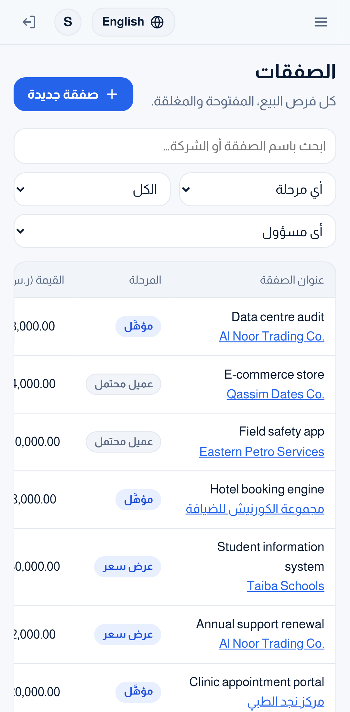
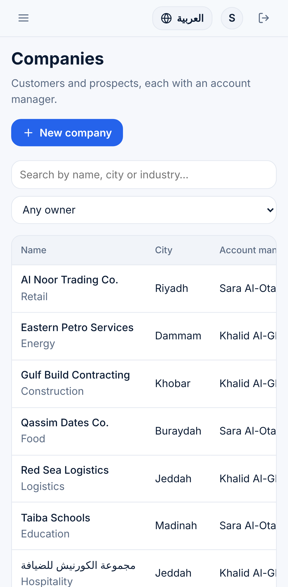

# ClientFlow Pro

A sales CRM for small B2B teams: companies, contacts, a deal pipeline, follow-up tasks and an activity log, in **Arabic and English** (RTL / LTR).

**Stack:** a Java 21 / Spring Boot 4 REST API, an Angular 21 frontend and PostgreSQL 17, all run with Docker Compose.

[العربية ↓](#بالعربية)

| Dashboard (Arabic) | Pipeline (English) |
| --- | --- |
|  |  |

| Mobile: deals | Mobile: companies |
| --- | --- |
|  |  |

## Features

- **Pipeline board.** Open deals are grouped by stage (Lead → Qualified → Proposal → Negotiation), with each column's count and value. You can move a deal from its card, or mark it won or lost. You can switch between "mine" and "whole team".
- **Deal rules enforced by the server.** Losing a deal requires a reason. Winning and reopening ask for confirmation. A closed deal cannot be edited until it is reopened. The contact must work at the deal's company. Every stage change is kept in a history with who changed it and when.
- **Weighted forecast.** Each stage has a probability (10 / 25 / 50 / 75 / 100 / 0 %), and the dashboard sums amount × probability.
- **Dashboard.** It shows the open pipeline, the forecast, deals won this month, the 90-day win rate (left empty when nothing has closed yet, rather than showing 0 %), your overdue tasks and tasks due today, deals closing in the next 30 days, top reps and recent activity. "Today" and "this month" use the Asia/Riyadh time zone.
- **Companies and contacts.** Each company has an account manager. The company page shows its deals, contacts, tasks and timeline. A company that still has deals or contacts cannot be deleted, and the message says how many of each it has.
- **Tasks.** Tasks have a due date, a priority and an assignee, and can be linked to a company or a deal. You can filter them by overdue, today or the next 7 days.
- **Activity log.** Calls, meetings, emails and notes are kept as an append-only timeline on each company and deal.
- **Ownership.** Sales reps edit only the records they own. Admins edit everything, delete records and manage users. Disabling an account or changing its role takes effect on the user's next request, not when their token expires.
- **Bilingual UI.** You can switch language without losing what you typed in a form. Every server error is translated using a stable error code.

## Quick start (Docker)

```bash
cp .env.example .env          # then set JWT_SECRET (e.g. openssl rand -base64 48) and DB_PASSWORD
docker compose up --build
```

Open <http://localhost:8082>. The API documentation (Swagger UI) is at <http://localhost:8082/swagger-ui/index.html>.

Demo accounts and sample data are created on the first start when `SEED_DEMO_DATA=true`:

| User | Password (default) | Role |
| --- | --- | --- |
| `admin` | `Admin@12345` | Admin |
| `sara` | `Sales@12345` | Sales rep |
| `khalid` | `Sales@12345` | Sales rep |

Change the passwords in `.env`. For a real installation, set `SEED_DEMO_DATA=false` and create users from the Users page.

## Local development

You need Java 21, Node 22 and Docker (for PostgreSQL and the Testcontainers tests).

```bash
docker run -d --name clientflow-db -e POSTGRES_DB=clientflow -e POSTGRES_USER=clientflow \
  -e POSTGRES_PASSWORD=clientflow -p 5432:5432 postgres:17-alpine
cd backend && ./mvnw spring-boot:run          # API on :8080
cd frontend && npm ci && npm start            # UI on :4200, /api is proxied to :8080
```

## Tests and checks

| Command | What it checks |
| --- | --- |
| `cd backend && ./mvnw verify` | 44 tests. Integration tests use a real PostgreSQL via Testcontainers: auth, roles and ownership, validation, the deal stage flow and history, tasks and activities, dashboard numbers and demo-data consistency. There are also unit tests for the domain rules. |
| `cd frontend && npm run lint` | ESLint, including the Angular template accessibility rules |
| `cd frontend && npm run format:check` | Prettier |
| `cd frontend && npm run check:i18n` | Every translation key used in templates exists |
| `cd frontend && npm run test:ci` | 20 unit tests: stage rules, input patterns, the move/win/lose flow, error mapping, Arabic/English dictionary parity |
| `cd e2e && npm ci && npx playwright test` | 22 browser tests (11 scenarios × desktop and mobile) against the running stack |

GitHub Actions runs all of these on every push. See `.github/workflows/ci.yml`.

## Project structure

```
backend/    Spring Boot API: one package per feature (company, contact, deal, task, activity, dashboard, user, ...)
  src/main/resources/db/migration   Flyway SQL migrations (the schema is never auto-generated)
frontend/   Angular app: core/ (api, auth, i18n, ui), features/ (one folder per area), layout/
e2e/        Playwright end-to-end tests
docs/       Screenshots
```

## Design decisions

- **Stage changes go through one endpoint** (`POST /api/deals/{id}/stage`). It validates the move, sets or clears `closedAt` and the lost reason, and writes the history row in the same transaction. A normal edit cannot change the stage.
- **Optimistic locking (`version`)** on every editable record. If two people edit the same deal, the second save gets a clear "someone else changed this" error instead of silently overwriting.
- **Ownership is checked in the services**, not only in the UI, so a sales rep cannot change a colleague's deal by calling the API directly.
- **Errors use RFC 9457 Problem Details** with a machine-readable `code` and per-field rules. The UI translates the code, so server messages are never shown raw.
- **Stateless JWT authentication** uses HMAC-SHA256. The secret is required at startup and must be at least 32 characters. The account is re-read on each request, so a disabled user is locked out immediately.

## Known limitations

- The company pickers in the deal form and the contacts page load up to 100 companies. A larger customer base would need a search-as-you-type picker.
- Each pipeline column shows the 50 most recently updated deals and a "N more" link to the full list.
- Activity times are shown in the browser's time zone. Task due dates and the dashboard use Riyadh time.
- The Docker images are built and started in CI. On the development machine used for this project, the stack was verified with the same runtime images and locally built artifacts.

---

## بالعربية

**ClientFlow Pro** نظام إدارة علاقات العملاء (CRM) لفرق المبيعات الصغيرة: شركات، وجهات اتصال، وخط مبيعات للصفقات، ومهام متابعة، وسجل نشاطات. واجهته **بالعربي والإنجليزي** (من اليمين لليسار ومن اليسار لليمين).

**التقنيات:** واجهة برمجية (API) بـ Java 21 وSpring Boot 4، وواجهة مستخدم بـ Angular 21، وقاعدة بيانات PostgreSQL 17، وكلها تشتغل بـ Docker Compose.

### المزايا

- **لوحة خط المبيعات.** الصفقات المفتوحة مقسّمة حسب المرحلة (عميل محتمل ← مؤهَّل ← عرض سعر ← تفاوض) مع عدد وقيمة كل عمود. تقدر تنقل الصفقة من بطاقتها أو تعلّمها رابحة أو خاسرة، وتبدّل بين "الخاصة بي" و"الفريق كامل".
- **قواعد الصفقات على الخادم.** الخسارة تتطلب سببًا، والفوز وإعادة الفتح يطلبون تأكيد. الصفقة المقفلة ما تتعدّل إلا بعد إعادة فتحها. وجهة الاتصال لازم تكون من نفس شركة الصفقة. وكل تغيير مرحلة ينحفظ في سجل فيه مين غيّره ومتى.
- **التوقع المرجّح.** لكل مرحلة نسبة احتمال (10 / 25 / 50 / 75 / 100 / 0 %)، ولوحة التحكم تجمع المبلغ × الاحتمال.
- **لوحة التحكم.** تعرض الصفقات المفتوحة، والتوقع، والفوز هذا الشهر، ونسبة الفوز آخر 90 يوم (تبقى فاضية إذا ما فيه صفقات مقفلة بدل ما تعرض 0%)، ومهامك المتأخرة ومهام اليوم، والصفقات المتوقع إغلاقها خلال 30 يوم، وأفضل المندوبين، وآخر النشاطات. "اليوم" و"الشهر" بتوقيت الرياض.
- **الشركات وجهات الاتصال.** لكل شركة مسؤول حساب، وصفحتها تعرض صفقاتها وجهات اتصالها ومهامها وسجل نشاطها. والشركة اللي عليها صفقات أو جهات اتصال ما تنحذف، والرسالة توضّح كم عليها من كل نوع.
- **المهام.** لكل مهمة تاريخ استحقاق وأولوية ومسؤول، وتقدر تربطها بشركة أو صفقة، وتفلترها: متأخرة، اليوم، أو الأيام السبعة الجاية.
- **سجل النشاطات.** المكالمات والاجتماعات والإيميلات والملاحظات تنحفظ كسجل زمني على كل شركة وصفقة، ولا تتعدّل بعد التسجيل.
- **الملكية.** المندوب يعدّل بس السجلات اللي يملكها، والمدير يعدّل كل شيء ويحذف ويدير المستخدمين. وتعطيل الحساب أو تغيير دوره يطبق من الطلب الجاي مباشرة، ما ينتظر انتهاء الرمز.
- **واجهة بلغتين.** تقدر تبدّل اللغة بدون ما تضيع البيانات المكتوبة في النماذج، وكل خطأ من الخادم يُترجم عن طريق رمز خطأ ثابت.

### التشغيل السريع

```bash
cp .env.example .env          # ثم عيّن JWT_SECRET (مثلًا openssl rand -base64 48) وDB_PASSWORD
docker compose up --build
```

افتح <http://localhost:8082>. توثيق الـ API (Swagger) على <http://localhost:8082/swagger-ui/index.html>.

الحسابات والبيانات التجريبية تنشأ أول مرة إذا كان `SEED_DEMO_DATA=true`:

| المستخدم | كلمة المرور (الافتراضية) | الدور |
| --- | --- | --- |
| `admin` | `Admin@12345` | مدير |
| `sara` | `Sales@12345` | مندوب مبيعات |
| `khalid` | `Sales@12345` | مندوب مبيعات |

غيّر كلمات المرور في `.env`. وفي التشغيل الفعلي خلّ `SEED_DEMO_DATA=false` وأنشئ المستخدمين من صفحة المستخدمين.

### الاختبارات

- **الباكند:** 44 اختبار على PostgreSQL حقيقي. تغطي الدخول والصلاحيات والملكية، والتحقق من المدخلات، ومسار مراحل الصفقة وسجلها، والمهام والنشاطات، وأرقام لوحة التحكم، وسلامة البيانات التجريبية.
- **الفرونت:** 20 اختبار وحدة، مع فحص ESLint (يشمل قواعد الوصولية) وPrettier، وفحص إن كل مفاتيح الترجمة موجودة.
- **اختبارات المتصفح (Playwright):** 22 اختبار على النظام وهو شغال، بالعربي والإنجليزي، على الكمبيوتر والجوال.

كلها تشتغل تلقائيًا في GitHub Actions مع كل push.

### حدود معروفة

- قوائم اختيار الشركة في نموذج الصفقة وصفحة جهات الاتصال تحمّل حتى 100 شركة. لو زاد العدد تحتاج منتقي بالبحث أثناء الكتابة.
- كل عمود في لوحة خط المبيعات يعرض آخر 50 صفقة تم تحديثها، مع رابط "N أخرى" للقائمة الكاملة.
- أوقات النشاطات تظهر بتوقيت المتصفح، أما تواريخ المهام ولوحة التحكم فبتوقيت الرياض.
- صور Docker تُبنى وتشتغل في CI. وعلى جهاز التطوير المستخدم لهذا المشروع، اختبرنا النظام بنفس صور التشغيل مع ملفات مبنية محليًا.
