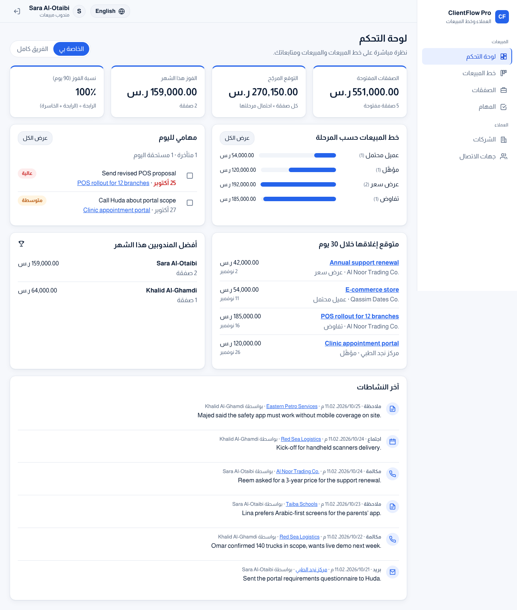
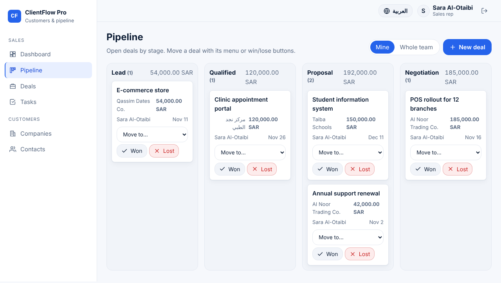
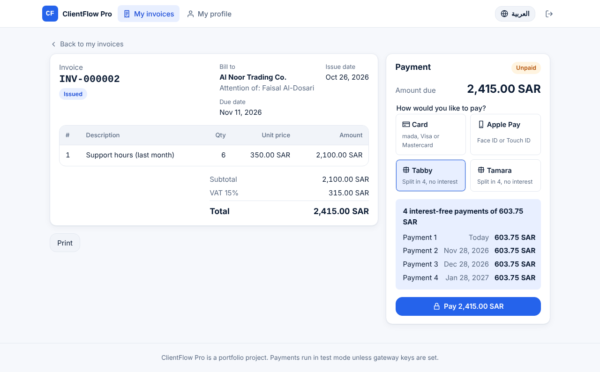
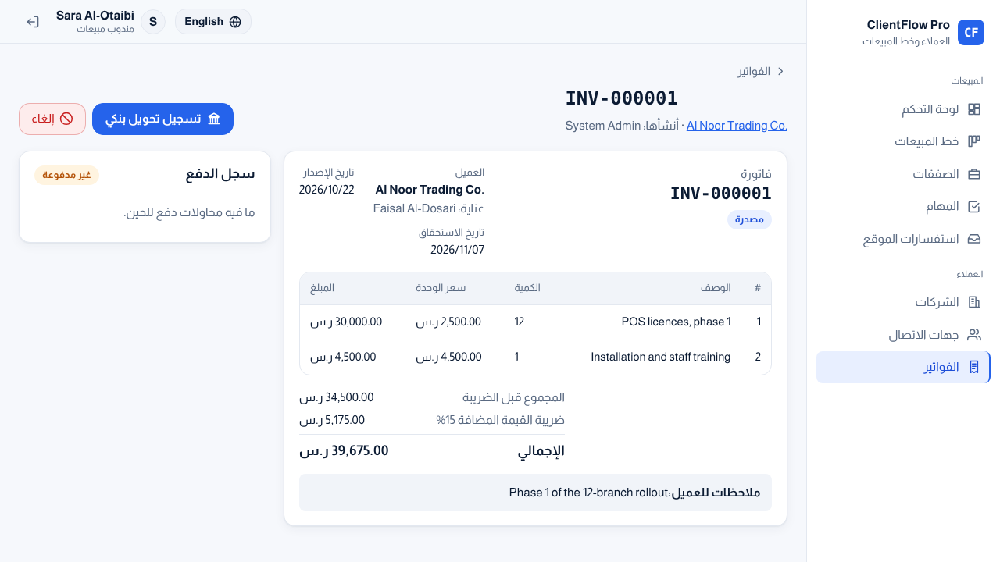
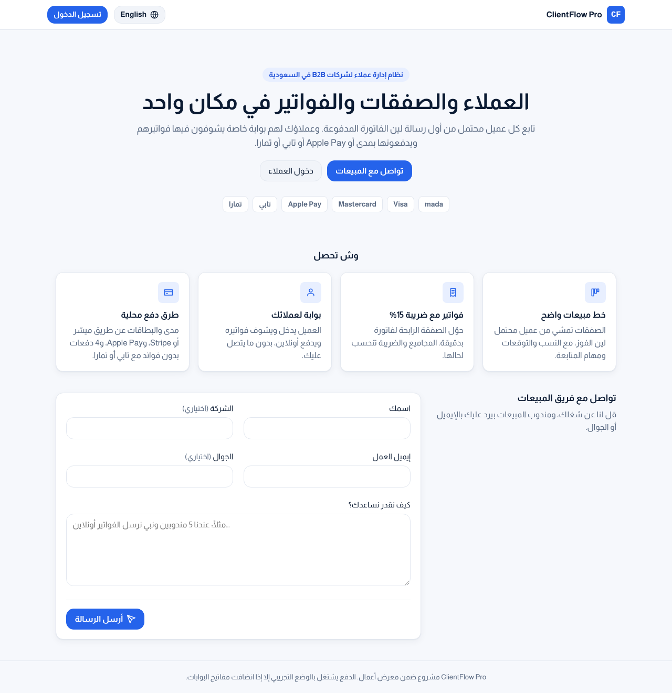
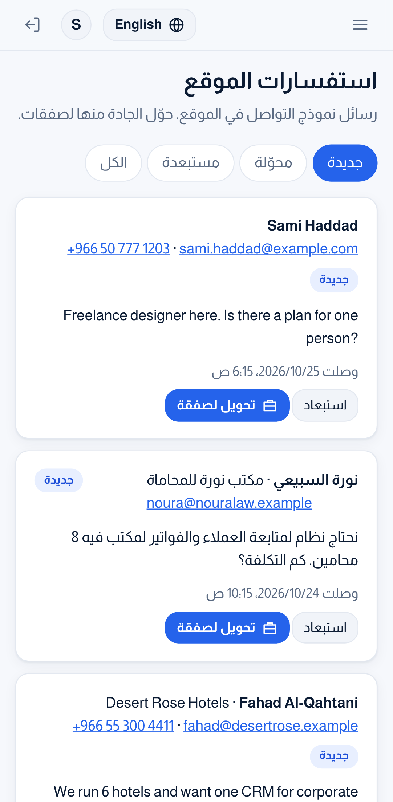

# ClientFlow Pro

A sales CRM for small B2B teams: companies, contacts, a deal pipeline, follow-up tasks, an activity log, **invoices with online payment**, a **client portal** and a **public website with a contact form**, in **Arabic and English** (RTL / LTR).

**Three kinds of users:** staff (admin and sales reps) use the CRM, clients sign in to their portal to see and pay invoices, and visitors use the public site.

**Stack:** a Java 21 / Spring Boot 4 REST API, an Angular 21 frontend and PostgreSQL 17, all run with Docker Compose.

[العربية ↓](#بالعربية)

| Dashboard (Arabic) | Pipeline (English) |
| --- | --- |
|  |  |

| Client portal: paying an invoice | Staff: invoice and payment history |
| --- | --- |
|  |  |

| Public website (Arabic) | Mobile: website inquiries |
| --- | --- |
|  |  |

## Features

- **Pipeline board.** Open deals are grouped by stage (Lead → Qualified → Proposal → Negotiation), with each column's count and value. You can move a deal from its card, or mark it won or lost. You can switch between "mine" and "whole team".
- **Deal rules enforced by the server.** Losing a deal requires a reason. Winning and reopening ask for confirmation. A closed deal cannot be edited until it is reopened. The contact must work at the deal's company. Every stage change is kept in a history with who changed it and when.
- **Weighted forecast.** Each stage has a probability (10 / 25 / 50 / 75 / 100 / 0 %), and the dashboard sums amount × probability.
- **Dashboard.** It shows the open pipeline, the forecast, deals won this month, the 90-day win rate (left empty when nothing has closed yet, rather than showing 0 %), your overdue tasks and tasks due today, deals closing in the next 30 days, top reps and recent activity. "Today" and "this month" use the Asia/Riyadh time zone.
- **Companies and contacts.** Each company has an account manager. The company page shows its deals, contacts, tasks and timeline. A company that still has deals or contacts cannot be deleted, and the message says how many of each it has.
- **Tasks.** Tasks have a due date, a priority and an assignee, and can be linked to a company or a deal. You can filter them by overdue, today or the next 7 days.
- **Activity log.** Calls, meetings, emails and notes are kept as an append-only timeline on each company and deal.
- **Ownership.** Sales reps edit only the records they own. Admins edit everything, delete records and manage users. Disabling an account or changing its role takes effect on the user's next request, not when their token expires.
- **Invoices.** Lines, quantities and prices with 15 % VAT calculated by the server (the form shows a live preview with the same rounding). A draft can be edited or deleted; issuing it publishes it to the client. An issued invoice can be marked paid by bank transfer (with the bank reference) or voided with a reason. Voiding a paid online invoice refunds it through its gateway. Numbers are sequential (`INV-000001`). A won deal has a "Create invoice" button that fills the company, contact and first line.
- **Online payments.** Card (mada, Visa, Mastercard) through **Moyasar** or **Stripe**, **Apple Pay**, and 4 interest-free payments with **Tabby** or **Tamara** (offered only between 100 and 5,000 SAR). Without API keys, a built-in **test gateway** runs the same flow with test cards, an Apple Pay sheet and the instalment plan screen, and no real money moves. With keys, the client is sent to the provider's page and the server confirms the result with the provider; the browser is never trusted.
- **Client portal.** A rep creates an invite link for a contact (the system sends no email; the link is shown once to copy and send). The client chooses a password and sees only their company's issued invoices, pays them, prints them and changes their password. The invite token is kept in the URL fragment, stored only as a SHA-256 hash, expires (7 days by default) and works once.
- **Public website.** A landing page with a "Talk to sales" form. Messages land in the team's **Website inquiries** inbox, where a rep converts one into a lead (company and contact are reused when they already exist, and the message is saved on the deal) or dismisses it. The form has a hidden spam trap.
- **Rate limits.** Per visitor IP: contact-form messages, and sign-in, invite and payment attempts.
- **Bilingual UI.** You can switch language without losing what you typed in a form. Every server error is translated using a stable error code.

## Quick start (Docker)

```bash
cp .env.example .env          # then set JWT_SECRET (e.g. openssl rand -base64 48) and DB_PASSWORD
docker compose up --build
```

Open <http://localhost:8082>. The API documentation (Swagger UI) is at <http://localhost:8082/swagger-ui/index.html>.

**Database.** PostgreSQL runs in the `db` container and keeps its data in the `db-data` Docker volume. Flyway creates the tables when the API starts. To browse it, connect a tool such as DBeaver to `localhost:5442`, database `clientflow`, with `DB_USERNAME` / `DB_PASSWORD` from `.env`. Or run `docker compose exec db psql -U clientflow -d clientflow`. `docker compose down -v` deletes the data.

Demo accounts and sample data are created on the first start when `SEED_DEMO_DATA=true`:

| User | Password (default) | Role |
| --- | --- | --- |
| `admin` | `Admin@12345` | Admin |
| `sara` | `Sales@12345` | Sales rep |
| `khalid` | `Sales@12345` | Sales rep |
| `faisal@alnoor.example` | `Client@12345` | Client (portal) |

The demo also has 9 invoices in every status (one paid by card, one by bank transfer, one overdue, one voided) and 5 website inquiries.

**Payments in test mode.** Pay any issued invoice from the portal. Test cards: `4111 1111 1111 1111` (approved), `4000 0000 0000 0002` (declined), `4000 0000 0000 9995` (insufficient funds), with any future expiry and any CVC. To use real gateways, put their test keys in `.env` (`CARD_PAYMENT_PROVIDER=MOYASAR` or `STRIPE`, `MOYASAR_SECRET_KEY`, `STRIPE_SECRET_KEY`, `TABBY_SECRET_KEY` + `TABBY_MERCHANT_CODE`, `TAMARA_API_TOKEN`) and set `PUBLIC_URL` to the address clients open.

Change the passwords in `.env`. For a real installation, set `SEED_DEMO_DATA=false` and create users from the Users page.

## Deployment

Every green CI run on `main` publishes ready-to-run images for amd64 and arm64:
`ghcr.io/viylxp/clientflow-pro-backend` and `ghcr.io/viylxp/clientflow-pro-frontend` (workflow `release.yml`).
The production server runs this app together with the other two Pro apps behind Caddy with automatic HTTPS,
nightly database backups, an optional nightly demo-data reset and automatic updates. Server files and steps: [`masar-pro/deploy`](https://github.com/viYLxP/masar-pro/tree/main/deploy).

## Local development

You need Java 21, Node 22 and Docker (for PostgreSQL and the Testcontainers tests).

```bash
docker run -d --name clientflow-db -e POSTGRES_DB=clientflow -e POSTGRES_USER=clientflow \
  -e POSTGRES_PASSWORD=clientflow -p 5432:5432 postgres:17-alpine
cd backend && ./mvnw spring-boot:run          # API on :8080
cd frontend && npm ci && npm start            # UI on :4200, /api is proxied to :8080
```

## Tests and checks

| Command | What it checks |
| --- | --- |
| `cd backend && ./mvnw verify` | 68 tests. Integration tests use a real PostgreSQL via Testcontainers: auth, roles and ownership, validation, the deal stage flow and history, tasks and activities, invoices and VAT, the client portal and invites, payments, inquiries, rate limits, dashboard numbers and demo-data consistency. Unit tests cover the domain rules and the gateway adapters (Moyasar, Stripe, Tabby, Tamara) against stubbed HTTP. |
| `cd frontend && npm run lint` | ESLint, including the Angular template accessibility rules |
| `cd frontend && npm run format:check` | Prettier |
| `cd frontend && npm run check:i18n` | Every translation key used in templates exists |
| `cd frontend && npm run test:ci` | 39 unit tests: stage rules, input patterns, the move/win/lose flow, VAT totals, the payment card, the invoice document, error mapping, Arabic/English dictionary parity |
| `cd e2e && npm ci && npx playwright test` | 40 browser tests (20 scenarios × desktop and mobile) against the running stack: building and issuing an invoice, paying by card (declined then approved) and with Tabby, bank transfer and void, inviting a client who activates the account, role separation, and a visitor's message converted into a lead |

GitHub Actions runs all of these on every push. See `.github/workflows/ci.yml`.

## Project structure

```
backend/    Spring Boot API: one package per feature (company, contact, deal, task, activity, invoice, payment, portal, inquiry, dashboard, user, ...)
  src/main/resources/db/migration   Flyway SQL migrations (the schema is never auto-generated)
frontend/   Angular app: core/ (api, auth, i18n, ui), features/ (one folder per area), shared/ (invoice and payment UI), layout/ (CRM shell, public site)
e2e/        Playwright end-to-end tests
docs/       Screenshots
```

## Design decisions

- **Stage changes go through one endpoint** (`POST /api/deals/{id}/stage`). It validates the move, sets or clears `closedAt` and the lost reason, and writes the history row in the same transaction. A normal edit cannot change the stage.
- **Optimistic locking (`version`)** on every editable record. If two people edit the same deal, the second save gets a clear "someone else changed this" error instead of silently overwriting.
- **Ownership is checked in the services**, not only in the UI, so a sales rep cannot change a colleague's deal by calling the API directly.
- **Errors use RFC 9457 Problem Details** with a machine-readable `code` and per-field rules. The UI translates the code, so server messages are never shown raw.
- **Invoice totals are computed only on the server**, in `BigDecimal` with VAT rounded half-up once on the subtotal. The database also checks `total = subtotal + vat` and `line_total = quantity × unit_price`, and allows only one paid payment per invoice.
- **A payment is confirmed by the server, never by the browser.** On return from a gateway the API asks the provider for the payment's status and checks the amount and currency before marking the invoice paid.
- **Clients are kept out of staff data at two layers:** URL rules in Spring Security (`/api/portal/**` is client-only, everything else staff-only) and the services (a client can only read their own company's issued invoices).
- **Stateless JWT authentication** uses HMAC-SHA256. The secret is required at startup and must be at least 32 characters. The account is re-read on each request, so a disabled user is locked out immediately.

## Known limitations

- The company pickers in the deal form and the contacts page load up to 100 companies. A larger customer base would need a search-as-you-type picker.
- Each pipeline column shows the 50 most recently updated deals and a "N more" link to the full list.
- Real gateway calls are tested against stubbed HTTP responses with each provider's documented format, not against the providers' live sandboxes (that needs merchant accounts and keys). Webhooks are not implemented: the result is checked with the provider when the client returns to the payment page, which also has a "Check again" button.
- Instalment payments (Tabby/Tamara) collect the full amount for the merchant; the plan itself is managed by the provider.
- The system does not send emails. Invite links are copied and sent by the rep.
- Activity times are shown in the browser's time zone. Task due dates and the dashboard use Riyadh time.
- The Docker images are built and started in CI. On the development machine used for this project, the stack was verified with the same runtime images and locally built artifacts.

---

## بالعربية

**ClientFlow Pro** نظام إدارة علاقات العملاء (CRM) لفرق المبيعات الصغيرة: شركات، وجهات اتصال، وخط مبيعات للصفقات، ومهام متابعة، وسجل نشاطات، و**فواتير مع دفع إلكتروني**، و**بوابة للعملاء**، و**موقع عام فيه نموذج تواصل**. واجهته **بالعربي والإنجليزي** (من اليمين لليسار ومن اليسار لليمين).

**ثلاث أنواع مستخدمين:** الموظفين (المدير والمندوبين) يستخدمون النظام، والعملاء يدخلون بوابتهم يشوفون فواتيرهم ويدفعونها، والزوار يستخدمون الموقع العام.

**التقنيات:** واجهة برمجية (API) بـ Java 21 وSpring Boot 4، وواجهة مستخدم بـ Angular 21، وقاعدة بيانات PostgreSQL 17، وكلها تشتغل بـ Docker Compose.

### المزايا

- **لوحة خط المبيعات.** الصفقات المفتوحة مقسّمة حسب المرحلة (عميل محتمل ← مؤهَّل ← عرض سعر ← تفاوض) مع عدد وقيمة كل عمود. تقدر تنقل الصفقة من بطاقتها أو تعلّمها رابحة أو خاسرة، وتبدّل بين "الخاصة بي" و"الفريق كامل".
- **قواعد الصفقات على الخادم.** الخسارة تتطلب سببًا، والفوز وإعادة الفتح يطلبون تأكيد. الصفقة المقفلة ما تتعدّل إلا بعد إعادة فتحها. وجهة الاتصال لازم تكون من نفس شركة الصفقة. وكل تغيير مرحلة ينحفظ في سجل فيه مين غيّره ومتى.
- **التوقع المرجّح.** لكل مرحلة نسبة احتمال (10 / 25 / 50 / 75 / 100 / 0 %)، ولوحة التحكم تجمع المبلغ × الاحتمال.
- **لوحة التحكم.** تعرض الصفقات المفتوحة، والتوقع، والفوز هذا الشهر، ونسبة الفوز آخر 90 يوم (تبقى فاضية إذا ما فيه صفقات مقفلة بدل ما تعرض 0%)، ومهامك المتأخرة ومهام اليوم، والصفقات المتوقع إغلاقها خلال 30 يوم، وأفضل المندوبين، وآخر النشاطات. "اليوم" و"الشهر" بتوقيت الرياض.
- **الشركات وجهات الاتصال.** لكل شركة مسؤول حساب، وصفحتها تعرض صفقاتها وجهات اتصالها ومهامها وسجل نشاطها. والشركة اللي عليها صفقات أو جهات اتصال ما تنحذف، والرسالة توضّح كم عليها من كل نوع.
- **المهام.** لكل مهمة تاريخ استحقاق وأولوية ومسؤول، وتقدر تربطها بشركة أو صفقة، وتفلترها: متأخرة، اليوم، أو الأيام السبعة الجاية.
- **سجل النشاطات.** المكالمات والاجتماعات والإيميلات والملاحظات تنحفظ كسجل زمني على كل شركة وصفقة، ولا تتعدّل بعد التسجيل.
- **الملكية.** المندوب يعدّل بس السجلات اللي يملكها، والمدير يعدّل كل شيء ويحذف ويدير المستخدمين. وتعطيل الحساب أو تغيير دوره يطبق من الطلب الجاي مباشرة، ما ينتظر انتهاء الرمز.
- **الفواتير.** بنود وكميات وأسعار مع ضريبة 15% يحسبها الخادم (والنموذج يعرض معاينة مباشرة بنفس التقريب). المسودة تتعدّل أو تنحذف، والإصدار ينشرها للعميل. الفاتورة المصدرة تقدر تسجّلها مدفوعة بتحويل بنكي (مع المرجع) أو تلغيها مع السبب، وإلغاء فاتورة مدفوعة أونلاين يرجّع المبلغ عن طريق بوابتها. الأرقام متسلسلة (`INV-000001`). والصفقة الرابحة فيها زر "إنشاء فاتورة" يعبّي الشركة وجهة الاتصال وأول بند.
- **الدفع الإلكتروني.** بطاقة (مدى، فيزا، ماستركارد) عن طريق **ميسّر** أو **Stripe**، و**Apple Pay**، و4 دفعات بدون فوائد مع **تابي** أو **تمارا** (تظهر بس للمبالغ من 100 إلى 5,000 ريال). وبدون مفاتيح API فيه **بوابة تجريبية** مدمجة تمشي نفس الخطوات ببطاقات تجريبية وشاشة Apple Pay وشاشة خطة التقسيط، بدون فلوس حقيقية. ومع المفاتيح العميل ينتقل لصفحة المزوّد، والخادم يتأكد من النتيجة عند المزوّد نفسه؛ وما يعتمد على المتصفح أبدًا.
- **بوابة العملاء.** المندوب يسوي رابط دعوة لجهة الاتصال (النظام ما يرسل إيميلات؛ الرابط ينعرض مرة وحدة عشان ينسخه ويرسله). العميل يختار كلمة مرور ويشوف بس فواتير شركته المصدرة، ويدفعها ويطبعها ويغيّر كلمة مروره. رمز الدعوة في جزء الـ # من الرابط، وينحفظ كـ SHA-256 بس، وينتهي (7 أيام افتراضيًا) ويشتغل مرة وحدة.
- **الموقع العام.** صفحة رئيسية فيها نموذج "تواصل مع المبيعات". الرسائل توصل لصندوق **استفسارات الموقع** عند الفريق، والمندوب يحوّلها لصفقة (ويعيد استخدام الشركة وجهة الاتصال لو موجودين، والرسالة تنحفظ في الصفقة) أو يستبعدها. والنموذج فيه مصيدة مخفية للروبوتات.
- **حدود الطلبات.** لكل IP زائر: رسائل نموذج التواصل، ومحاولات الدخول والدعوة والدفع.
- **واجهة بلغتين.** تقدر تبدّل اللغة بدون ما تضيع البيانات المكتوبة في النماذج، وكل خطأ من الخادم يُترجم عن طريق رمز خطأ ثابت.

### التشغيل السريع

```bash
cp .env.example .env          # ثم عيّن JWT_SECRET (مثلًا openssl rand -base64 48) وDB_PASSWORD
docker compose up --build
```

افتح <http://localhost:8082>. توثيق الـ API (Swagger) على <http://localhost:8082/swagger-ui/index.html>.

**قاعدة البيانات.** PostgreSQL يشتغل داخل حاوية `db` وبياناته محفوظة في volume اسمه `db-data`. والجداول ينشئها Flyway تلقائيًا لما يشتغل الـ API. عشان تتصفحها، وصّل أداة مثل DBeaver على `localhost:5442`، قاعدة البيانات `clientflow`، باسم المستخدم وكلمة المرور من `.env` (`DB_USERNAME` و`DB_PASSWORD`). أو شغّل `docker compose exec db psql -U clientflow -d clientflow`. والأمر `docker compose down -v` يحذف البيانات.

الحسابات والبيانات التجريبية تنشأ أول مرة إذا كان `SEED_DEMO_DATA=true`:

| المستخدم | كلمة المرور (الافتراضية) | الدور |
| --- | --- | --- |
| `admin` | `Admin@12345` | مدير |
| `sara` | `Sales@12345` | مندوب مبيعات |
| `khalid` | `Sales@12345` | مندوب مبيعات |
| `faisal@alnoor.example` | `Client@12345` | عميل (البوابة) |

وفيه كمان 9 فواتير بكل الحالات (وحدة مدفوعة بالبطاقة، ووحدة بتحويل بنكي، ووحدة متأخرة، ووحدة ملغاة) و5 استفسارات من الموقع.

**الدفع بالوضع التجريبي.** ادفع أي فاتورة مصدرة من البوابة. البطاقات التجريبية: `4111 1111 1111 1111` (مقبولة)، `4000 0000 0000 0002` (مرفوضة)، `4000 0000 0000 9995` (رصيد غير كافي)، مع أي تاريخ انتهاء مستقبلي وأي CVC. ولتشغيل البوابات الحقيقية حط مفاتيحها التجريبية في `.env` (`CARD_PAYMENT_PROVIDER=MOYASAR` أو `STRIPE`، و`MOYASAR_SECRET_KEY`، و`STRIPE_SECRET_KEY`، و`TABBY_SECRET_KEY` مع `TABBY_MERCHANT_CODE`، و`TAMARA_API_TOKEN`) وخل `PUBLIC_URL` هو العنوان اللي يفتحه العملاء.

غيّر كلمات المرور في `.env`. وفي التشغيل الفعلي خلّ `SEED_DEMO_DATA=false` وأنشئ المستخدمين من صفحة المستخدمين.

### الرفع على سيرفر

كل تشغيل CI ناجح على `main` ينشر صور جاهزة (amd64 وarm64) في `ghcr.io/viylxp/clientflow-pro-backend` و`-frontend`.
والسيرفر يشغّل هذا التطبيق مع تطبيقي Pro الثانيين خلف Caddy بشهادة HTTPS تلقائية، ونسخ احتياطي يومي،
وتصفير اختياري لبيانات العرض كل ليلة، وتحديث تلقائي. الملفات والخطوات: [`masar-pro/deploy`](https://github.com/viYLxP/masar-pro/tree/main/deploy).

### الاختبارات

- **الباكند:** 68 اختبار على PostgreSQL حقيقي. تغطي الدخول والصلاحيات والملكية، والتحقق من المدخلات، ومسار مراحل الصفقة وسجلها، والمهام والنشاطات، والفواتير والضريبة، وبوابة العملاء والدعوات، والدفع، والاستفسارات، وحدود الطلبات، وأرقام لوحة التحكم، وسلامة البيانات التجريبية. ومعها اختبارات وحدة لربط بوابات الدفع (ميسّر وStripe وتابي وتمارا) على ردود HTTP محاكية.
- **الفرونت:** 39 اختبار وحدة، مع فحص ESLint (يشمل قواعد الوصولية) وPrettier، وفحص إن كل مفاتيح الترجمة موجودة.
- **اختبارات المتصفح (Playwright):** 40 اختبار على النظام وهو شغال، بالعربي والإنجليزي، على الكمبيوتر والجوال: إنشاء فاتورة وإصدارها، والدفع بالبطاقة (مرفوضة ثم مقبولة) وبتابي، والتحويل البنكي والإلغاء، ودعوة عميل يفعّل حسابه، وفصل الصلاحيات، ورسالة زائر تتحول لصفقة.

كلها تشتغل تلقائيًا في GitHub Actions مع كل push.

### حدود معروفة

- قوائم اختيار الشركة في نموذج الصفقة وصفحة جهات الاتصال تحمّل حتى 100 شركة. لو زاد العدد تحتاج منتقي بالبحث أثناء الكتابة.
- كل عمود في لوحة خط المبيعات يعرض آخر 50 صفقة تم تحديثها، مع رابط "N أخرى" للقائمة الكاملة.
- ربط البوابات الحقيقية مختبر على ردود HTTP محاكية بنفس صيغة كل مزوّد، مو على بيئاتهم التجريبية مباشرة (هذا يحتاج حسابات تاجر ومفاتيح). والـ webhooks مو مطبّقة: النتيجة تنفحص عند المزوّد لما يرجع العميل لصفحة الدفع، وفيها زر "تحقق مرة ثانية".
- التقسيط (تابي/تمارا) يحصّل المبلغ كامل للتاجر، والخطة نفسها يديرها المزوّد.
- النظام ما يرسل إيميلات؛ روابط الدعوة ينسخها المندوب ويرسلها.
- أوقات النشاطات تظهر بتوقيت المتصفح، أما تواريخ المهام ولوحة التحكم فبتوقيت الرياض.
- صور Docker تُبنى وتشتغل في CI. وعلى جهاز التطوير المستخدم لهذا المشروع، اختبرنا النظام بنفس صور التشغيل مع ملفات مبنية محليًا.
